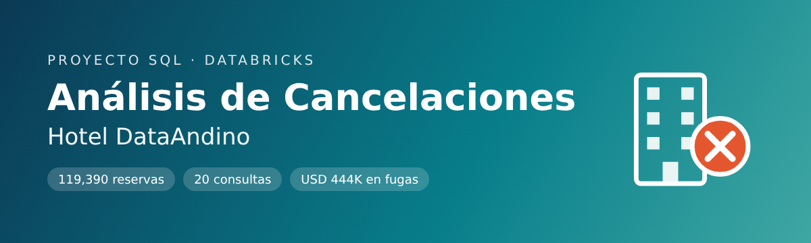

# Proyecto SQL: Análisis de Cancelaciones en Hotel DataAndino usando SQL-Databricks

## Resumen (Overview)
_El holding hotelero **DataAndino** descubrió que sus contratos con agencias de marketing no contemplan las cancelaciones: el hotel paga **USD 1.5** por cada reserva generada por la agencia, aunque el huésped cancele después. Además, cada cancelación hecha con menos de 3 días de anticipación genera un costo operativo hundido de **USD 120**. Como Analista de Datos, mi objetivo es usar **SQL** en **Databricks** para cuantificar esta fuga de dinero y analizar el perfil de las reservas canceladas, y así ayudar a la empresa a renegociar sus contratos._

## 📩 Conéctate conmigo
<p align="center">
  <a href="https://github.com/Jorge16-0">
    
  </a>
</p>

## Estructura del Proyecto

- [Sobre los Datos](#sobre-los-datos)
- [Tareas](#tareas-task)
- [Limpieza de Datos](#limpieza-de-datos)
- [Parte 1: Limpieza, Exploración y Modificaciones](#parte-1-limpieza-exploración-y-modificaciones)
- [Parte 2: Impacto Financiero y JOINS](#parte-2-impacto-financiero-y-joins)
- [Parte 3: Validación de Hipótesis de Cancelación](#parte-3-validación-de-hipótesis-de-cancelación)
- [Conclusión](#conclusión)

## Sobre los Datos

Los datos originales, junto con una explicación de cada columna, se pueden encontrar [aquí](https://www.kaggle.com/datasets/jessemostipak/hotel-booking-demand). Provienen del artículo _"Hotel booking demand datasets"_ (Antonio, Almeida & Nunes, 2019, _Data in Brief_) y corresponden a dos hoteles de Portugal: un **City Hotel** y un **Resort Hotel**.

El conjunto de datos tiene **119,390 reservas** y **32 columnas**, con llegadas entre julio de 2015 y agosto de 2017. Se cargó en Databricks como la tabla `workspace.hotel_db.tb_reservas`. Las columnas principales del análisis son `hotel`, `is_canceled`, `lead_time`, `distribution_channel`, `adr`, `children`, `babies`, `total_of_special_requests`, `booking_changes` y `reservation_status_date`.

## Tareas (Task)

En este análisis, ayudo a DataAndino a responder lo siguiente:

**Parte 1 – Limpieza, Exploración y Modificaciones**
1. **CREATE / INSERT:** crear una tabla de prueba con las reservas canceladas del City Hotel.
2. **UPDATE:** corregir el error de captura en la columna `babies`.
3. **CAST / CONCAT:** construir una fecha de llegada legible ("DD-Mes-YYYY").
4. **LIKE:** filtrar los canales de distribución que empiezan con "T".
5. **COUNT / SUM / AVG:** calcular los indicadores globales del hotel.
6. **DELETE:** eliminar las reservas de prueba con `adr = 0`.
7. **GROUP BY:** contar las reservas por canal de distribución.
8. **CASE WHEN:** clasificar las reservas por rango de precio.
9. **DATE_SUB:** obtener la fecha exacta en que se hizo la reserva.
10. **CEIL:** calcular los meses de anticipación redondeados hacia arriba.

**Parte 2 – Impacto Financiero y JOINS**

11. **Marketing inútil:** ¿cuánto se pagó a la agencia por reservas canceladas?
12. **Cancelaciones tardías:** ¿cuánto se pierde por cancelaciones con menos de 3 días de anticipación?
13. **LEFT JOIN:** cruzar las reservas con el catálogo de países.
14. **INNER JOIN:** encontrar los 5 países con más cancelaciones.
15. **FULL OUTER JOIN:** detectar reservas sin vendedor y vendedores sin reservas.
16. **RIGHT JOIN:** ver todas las facturas emitidas con su tipo de hotel.

**Parte 3 – Validación de Hipótesis**

17. ¿Los hijos aseguran el viaje?
18. ¿Más solicitudes especiales significan menos cancelaciones?
19. ¿Cambiar la reserva es señal de compromiso?
20. ¿En qué tipo de hotel es más alto el precio promedio de las reservas canceladas?

## Limpieza de Datos

Antes del análisis preparé la tabla `tb_reservas` a partir del CSV original (`tb_reservas_raw`). El CSV no trae una columna de fecha de llegada ni un identificador de reserva, y `children` viene como texto porque tiene valores "NA".

#### Preparación de la tabla

Convertí `children` a número con `TRY_CAST`, armé `arrival_date` uniendo año, mes y día con `TO_DATE`, y generé un `id_reserva` con `ROW_NUMBER()`. Para los ejercicios de JOIN 13 a 16 creé también tres tablas auxiliares simuladas: `tb_paises`, `tb_vendedores` y `tb_facturas` (el script completo está en [`Hotel_Cancelaciones_All_Queries.sql`](./Hotel_Cancelaciones_All_Queries.sql)).

```sql
CREATE OR REPLACE TABLE tb_reservas AS
SELECT
  r.* EXCEPT (children, reservation_status_date, adr),
  TRY_CAST(r.children AS INT)                        AS children,
  CAST(r.adr AS DOUBLE)                              AS adr,
  TO_DATE(CAST(r.reservation_status_date AS STRING)) AS reservation_status_date,
  TO_DATE(CONCAT(r.arrival_date_year, '-', r.arrival_date_month, '-',
                 r.arrival_date_day_of_month), 'yyyy-MMMM-d') AS arrival_date,
  ROW_NUMBER() OVER (ORDER BY r.arrival_date_year, r.arrival_date_week_number,
                              r.arrival_date_day_of_month, r.hotel, r.lead_time) AS id_reserva
FROM tb_reservas_raw r;
```

#### Valores Nulos o Faltantes

Verifiqué los nulos en las columnas clave. Solo hay **4 nulos en `children`** y **488 reservas sin país**, menos del 0.5% del total, así que no afectan el análisis. En las consultas que usan `children` los trato con `COALESCE`.

```sql
-- Verificar valores faltantes en columnas clave --

SELECT
  SUM(CASE WHEN hotel IS NULL THEN 1 ELSE 0 END)                       AS nulos_hotel,
  SUM(CASE WHEN is_canceled IS NULL THEN 1 ELSE 0 END)                 AS nulos_is_canceled,
  SUM(CASE WHEN children IS NULL THEN 1 ELSE 0 END)                    AS nulos_children,
  SUM(CASE WHEN country IS NULL OR country = 'NULL' THEN 1 ELSE 0 END) AS nulos_country,
  SUM(CASE WHEN adr IS NULL THEN 1 ELSE 0 END)                         AS nulos_adr,
  SUM(CASE WHEN arrival_date IS NULL THEN 1 ELSE 0 END)                AS nulos_arrival_date
FROM tb_reservas;
```

#### Valores Duplicados

Encontré **31,994 filas idénticas** en todas sus columnas. El dataset no trae un identificador único de reserva, así que esas filas pueden ser reservas reales distintas (por ejemplo, grupos que reservan varias habitaciones iguales el mismo día). Por eso decidí **no eliminarlas**: el proyecto pide trabajar sobre la tabla completa.

```sql
-- Verificar filas duplicadas --

SELECT
  COUNT(*) AS total_filas,
  COUNT(*) - (SELECT COUNT(*)
              FROM (SELECT DISTINCT * EXCEPT (id_reserva, id_vendedor)
                    FROM tb_reservas)) AS filas_duplicadas
FROM tb_reservas;
```

#### Valores Atípicos en el Precio

Hay **1 reserva con `adr` negativo**, **1,959 con `adr = 0`** y un máximo de **USD 5,400** por noche. Las reservas con precio 0 se eliminan en la tabla de pruebas (ejercicio 6).

```sql
-- Verificar valores atípicos en adr --

SELECT
  SUM(CASE WHEN adr < 0 THEN 1 ELSE 0 END) AS adr_negativo,
  SUM(CASE WHEN adr = 0 THEN 1 ELSE 0 END) AS adr_cero,
  MAX(adr)                                 AS adr_maximo
FROM tb_reservas;
```

---

## Parte 1: Limpieza, Exploración y Modificaciones

### Pregunta #1: Crear una tabla de prueba con las reservas canceladas del City Hotel (CREATE / INSERT)

Usé `DROP TABLE IF EXISTS` para limpiar una versión anterior, `CREATE TABLE ... LIKE` para copiar la estructura de `tb_reservas` y luego `INSERT INTO ... SELECT` con un filtro `WHERE`. La creé como tabla Delta y no como vista temporal, porque las preguntas 2 y 6 necesitan `UPDATE` y `DELETE`, que no funcionan sobre vistas.

```sql
DROP TABLE IF EXISTS tb_reservas_prueba;
CREATE TABLE tb_reservas_prueba LIKE tb_reservas;

INSERT INTO tb_reservas_prueba
SELECT *
FROM tb_reservas
WHERE hotel = 'City Hotel'
  AND is_canceled = 1;

SELECT COUNT(*) AS reservas_insertadas FROM tb_reservas_prueba;
```

**Conclusión:** la tabla de prueba quedó con **33,102 reservas canceladas** del City Hotel. Así el equipo comercial puede experimentar sin tocar la tabla productiva.

### Pregunta #2: Corregir el error de captura en `babies` (UPDATE)

Con un `UPDATE` sin `WHERE` cambié `babies` a 0 en todos los registros, y verifiqué el resultado con `SUM`.

```sql
UPDATE tb_reservas_prueba
SET babies = 0;

SELECT SUM(babies) AS total_babies_post_update FROM tb_reservas_prueba;
```

**Conclusión:** la suma de `babies` quedó en **0**, así que el error del canal está corregido en la tabla de prueba.

### Pregunta #3: Fecha de llegada legible (CAST / CONCAT)

Usé `CAST` para convertir el día y el año a texto, `LPAD` para que el día tenga siempre dos dígitos y `CONCAT` para unir todo con guiones.

```sql
SELECT
  arrival_date_year,
  arrival_date_month,
  arrival_date_day_of_month,
  CONCAT(
    LPAD(CAST(arrival_date_day_of_month AS STRING), 2, '0'), '-',
    arrival_date_month, '-',
    CAST(arrival_date_year AS STRING)
  ) AS arrival_date_string
FROM tb_reservas;
```

**Conclusión:** la fecha queda legible (ej. `01-July-2015`), lista para reportes que lea el equipo comercial.

### Pregunta #4: Canales de distribución que empiezan con "T" (LIKE)

Usé `LIKE 'T%'`, donde `%` representa cualquier texto después de la "T".

```sql
SELECT *
FROM tb_reservas
WHERE distribution_channel LIKE 'T%';
```

**Conclusión:** el único canal que cumple es `TA/TO` (agencias), con **97,870 reservas, el 82% del total**. La agencia es, por lejos, el canal dominante.

### Pregunta #5: Indicadores globales del hotel (COUNT / SUM / AVG)

Calculé los tres indicadores en una sola consulta con funciones de agregación, y redondeé el precio con `ROUND`.

```sql
SELECT
  COUNT(*)                       AS total_reservas,
  SUM(total_of_special_requests) AS total_solicitudes_especiales,
  ROUND(AVG(adr), 2)             AS adr_promedio
FROM tb_reservas;
```

**Conclusión:** el hotel registra **119,390 reservas**, **68,215 solicitudes especiales** y un precio promedio de **USD 101.83 por noche**.

### Pregunta #6: Eliminar las reservas de prueba con precio 0 (DELETE)

Usé `DELETE` con un `WHERE` para borrar solo las reservas con `adr = 0.0`.

```sql
DELETE FROM tb_reservas_prueba
WHERE adr = 0.0;

SELECT COUNT(*) AS reservas_restantes FROM tb_reservas_prueba;
```

**Conclusión:** se eliminaron **129 reservas de prueba del sistema**, y quedan **32,973 reservas reales** en la tabla de prueba.

### Pregunta #7: Reservas por canal de distribución (GROUP BY)

Agrupé por `distribution_channel`, conté las reservas con `COUNT` y las ordené de mayor a menor.

```sql
SELECT
  distribution_channel,
  COUNT(*) AS cantidad_reservas
FROM tb_reservas
GROUP BY distribution_channel
ORDER BY cantidad_reservas DESC;
```

**Conclusión:** `TA/TO` (97,870) supera ampliamente a `Direct` (14,645) y `Corporate` (6,677). Por esa dependencia de la agencia, cualquier mejora en su contrato tiene un gran impacto en las finanzas.

### Pregunta #8: Clasificación de reservas por precio (CASE WHEN)

Con `CASE WHEN` creé tres categorías de precio. Además, agrupé por categoría para ver cuántas reservas hay en cada una.

```sql
SELECT
  hotel,
  adr,
  CASE
    WHEN adr < 50               THEN 'Económico'
    WHEN adr BETWEEN 50 AND 150 THEN 'Estándar'
    ELSE                             'Premium'
  END AS categoria_precio
FROM tb_reservas;

-- Resumen por categoría --
SELECT
  CASE
    WHEN adr < 50               THEN 'Económico'
    WHEN adr BETWEEN 50 AND 150 THEN 'Estándar'
    ELSE                             'Premium'
  END AS categoria_precio,
  COUNT(*) AS cantidad_reservas
FROM tb_reservas
GROUP BY 1
ORDER BY cantidad_reservas DESC;
```

**Conclusión:** el **76% de las reservas son Estándar** (91,293), seguidas de Premium (16,508) y Económico (11,589).

### Pregunta #9: Fecha exacta de la reserva (DATE_SUB)

Usé `DATE_SUB` para restar los días de `lead_time` a la fecha de llegada. Como Databricks cargó `lead_time` como `BIGINT` y `DATE_SUB` solo acepta `INT`, lo convertí con `CAST(lead_time AS INT)`.

```sql
SELECT
  arrival_date,
  lead_time,
  DATE_SUB(arrival_date, CAST(lead_time AS INT)) AS booking_date
FROM tb_reservas;
```

**Conclusión:** ahora se conoce la fecha real de cada reserva (ej. una llegada el `2015-07-01` con 65 días de anticipación se reservó el `2015-04-27`).

### Pregunta #10: Meses de anticipación (CEIL)

Dividí `lead_time` entre 30 y usé `CEIL` para redondear hacia arriba.

```sql
SELECT
  lead_time,
  CEIL(lead_time / 30) AS meses_anticipacion_techo
FROM tb_reservas;
```

**Conclusión:** la anticipación queda en meses (ej. 92 días → 4 meses), lo que sirve para segmentar el riesgo según qué tan lejos se reservó.

---

## Parte 2: Impacto Financiero y JOINS

### Pregunta #11: El costo del marketing inútil

Filtré las reservas del canal `TA/TO` que se cancelaron, las conté y multipliqué el total por USD 1.5.

```sql
SELECT
  COUNT(*)       AS reservas_agencia_canceladas,
  COUNT(*) * 1.5 AS perdida_comision_usd
FROM tb_reservas
WHERE distribution_channel = 'TA/TO'
  AND is_canceled = 1;
```

**Conclusión:** se pagaron **USD 60,228** a la agencia por **40,152 reservas que se cancelaron**, el 41% de todo lo que trae la agencia. Conviene renegociar para pagar solo por las estadías efectivas.

### Pregunta #12: El costo de cancelar tarde (DATEDIFF)

Usé `DATEDIFF` para calcular los días entre la cancelación y la llegada, filtré las que tuvieron menos de 3 días y multipliqué el total por USD 120.

```sql
SELECT
  COUNT(*)       AS cancelaciones_tardias,
  COUNT(*) * 120 AS perdida_operativa_usd
FROM tb_reservas
WHERE is_canceled = 1
  AND DATEDIFF(arrival_date, reservation_status_date) < 3;
```

**Conclusión:** **3,204 cancelaciones de último minuto** cuestan **USD 384,480**, más de 6 veces la pérdida por comisiones. Una penalidad o un depósito para cancelaciones con menos de 72 horas debería ser la prioridad.

### Pregunta #13: Reservas con nombre de país (LEFT JOIN)

Usé `LEFT JOIN` para conservar todas las reservas, aunque su país no esté en el catálogo `tb_paises`.

```sql
SELECT
  r.is_canceled,
  r.country,
  p.nombre_pais
FROM tb_reservas r
LEFT JOIN tb_paises p
  ON r.country = p.cod_pais;
```

**Conclusión:** se mantienen las 119,390 reservas. Las que tienen un país fuera del catálogo aparecen con `nombre_pais = NULL`, y eso revela vacíos en la tabla maestra de países.

### Pregunta #14: Top 5 países con más cancelaciones (INNER JOIN)

Usé `INNER JOIN` para quedarme solo con los países del catálogo. Luego filtré las cancelaciones, agrupé por país y usé `LIMIT 5`.

```sql
SELECT
  p.nombre_pais,
  COUNT(*) AS reservas_canceladas
FROM tb_reservas r
INNER JOIN tb_paises p
  ON r.country = p.cod_pais
WHERE r.is_canceled = 1
GROUP BY p.nombre_pais
ORDER BY reservas_canceladas DESC
LIMIT 5;
```

**Conclusión:** **Portugal (27,519)** concentra la gran mayoría de las cancelaciones, seguido de Reino Unido (2,453), España (2,177), Francia (1,934) e Italia (1,333). Las políticas de retención deberían enfocarse en el mercado local.

### Pregunta #15: Reservas y vendedores (FULL OUTER JOIN)

Usé `FULL OUTER JOIN` para traer todas las filas de ambas tablas, coincidan o no. Agregué un resumen con `CASE WHEN` para contar los casos sin pareja.

```sql
SELECT
  r.id_reserva,
  r.distribution_channel,
  v.nombre_vendedor
FROM tb_reservas r
FULL OUTER JOIN tb_vendedores v
  ON r.id_vendedor = v.id_vendedor;

-- Resumen del cruce --
SELECT
  CASE
    WHEN r.id_reserva IS NULL  THEN 'Vendedor sin reservas'
    WHEN v.id_vendedor IS NULL THEN 'Reserva sin vendedor'
    ELSE                            'Reserva con vendedor'
  END                                           AS estado_cruce,
  COALESCE(v.nombre_vendedor, '(sin vendedor)') AS nombre_vendedor,
  COUNT(r.id_reserva)                           AS cantidad_reservas
FROM tb_reservas r
FULL OUTER JOIN tb_vendedores v
  ON r.id_vendedor = v.id_vendedor
GROUP BY 1, 2
ORDER BY 1, 2;
```

**Conclusión:** el cruce detecta **11,939 reservas sin vendedor** y **1 vendedora sin reservas asignadas**. _(Tabla de vendedores simulada.)_

### Pregunta #16: Facturas con su tipo de hotel (RIGHT JOIN)

Usé `RIGHT JOIN` para garantizar que aparezcan todas las facturas de `tb_facturas`, aunque no tengan una reserva asociada.

```sql
SELECT
  f.id_reserva,
  f.monto_facturado,
  r.hotel
FROM tb_reservas r
RIGHT JOIN tb_facturas f
  ON r.id_reserva = f.id_reserva
ORDER BY r.hotel NULLS FIRST, f.id_reserva;
```

**Conclusión:** se ven las 503 facturas, y **3 de ellas no tienen reserva asociada** (`hotel = NULL`). Contabilidad debería auditarlas. _(Tabla de facturas simulada.)_

---

## Parte 3: Validación de Hipótesis de Cancelación

### Pregunta #17 – Hipótesis 1: ¿Los hijos aseguran el viaje?

Con `CASE WHEN` separé las reservas con y sin hijos. Calculé la tasa de cancelación como `AVG(is_canceled)`, que es la proporción de reservas canceladas. Usé `COALESCE` para que los 4 nulos de `children` no rompan la clasificación.

```sql
SELECT
  CASE
    WHEN COALESCE(children, 0) > 0 OR COALESCE(babies, 0) > 0 THEN 'Con Hijos'
    ELSE 'Sin Hijos'
  END                              AS segmento,
  COUNT(*)                         AS total_reservas,
  SUM(is_canceled)                 AS reservas_canceladas,
  ROUND(AVG(is_canceled) * 100, 2) AS tasa_cancelacion_pct
FROM tb_reservas
GROUP BY 1
ORDER BY tasa_cancelacion_pct DESC;
```

**Conclusión:** el segmento **Sin Hijos cancela más (37.22%)** que el segmento Con Hijos (34.92%), pero la diferencia es pequeña. Tener hijos reduce un poco el riesgo, aunque no "asegura" el viaje.

### Pregunta #18 – Hipótesis 2: El impacto de las solicitudes especiales

Agrupé por la cantidad de solicitudes especiales y calculé la tasa de cancelación de cada grupo, en orden ascendente.

```sql
SELECT
  total_of_special_requests,
  COUNT(*)                         AS total_reservas,
  ROUND(AVG(is_canceled) * 100, 2) AS tasa_cancelacion_pct
FROM tb_reservas
GROUP BY total_of_special_requests
ORDER BY total_of_special_requests ASC;
```

**Conclusión:** **a más solicitudes, menos cancelaciones.** Sin solicitudes cancela el **47.7%**, pero con 5 solicitudes solo el **5%**. Incentivar que el cliente personalice su estadía ayuda a retenerlo.

### Pregunta #19 – Hipótesis 3: ¿Cambiar la reserva es señal de compromiso?

Con `CASE WHEN` agrupé `booking_changes` en tres categorías y calculé la tasa de cancelación de cada una.

```sql
SELECT
  CASE
    WHEN booking_changes = 0             THEN 'Sin Cambios'
    WHEN booking_changes BETWEEN 1 AND 3 THEN '1 a 3 cambios'
    ELSE                                      'Más de 3 cambios'
  END                              AS grupo_cambios,
  COUNT(*)                         AS total_reservas,
  ROUND(AVG(is_canceled) * 100, 2) AS tasa_cancelacion_pct
FROM tb_reservas
GROUP BY 1
ORDER BY tasa_cancelacion_pct ASC;
```

**Conclusión:** sí. Quienes hacen **1 a 3 cambios tienen el menor riesgo (15.59%)**, y quienes nunca modifican su reserva cancelan 2.6 veces más (40.85%).

### Pregunta #20 – Hipótesis 4: El factor precio (adr)

Agrupé por tipo de hotel. Conté las cancelaciones con `SUM(is_canceled)` y, con un `CASE WHEN` dentro del `AVG`, calculé el precio promedio solo de las reservas canceladas.

```sql
SELECT
  hotel,
  SUM(is_canceled)                                      AS total_cancelaciones,
  ROUND(AVG(CASE WHEN is_canceled = 1 THEN adr END), 2) AS adr_promedio_canceladas
FROM tb_reservas
GROUP BY hotel
ORDER BY adr_promedio_canceladas DESC;
```

**Conclusión:** el **Resort Hotel tiene el precio promedio de cancelación más alto (USD 105.79)**, frente a USD 104.69 del City Hotel. Sin embargo, el problema real está en el City Hotel, que tiene 3 veces más cancelaciones (33,102).

---

## Conclusión

- Este análisis cuantificó la fuga de dinero de DataAndino por cancelaciones: **USD 60,228** en comisiones pagadas por reservas canceladas y **USD 384,480** en costos hundidos por cancelaciones de último minuto.

- La agencia (`TA/TO`) trae el 82% de las reservas, pero el 41% de ellas termina cancelada. Conviene **renegociar el contrato para pagar solo por estadías efectivas**.

- La mayor pérdida está en las cancelaciones tardías. Se recomienda **una penalidad o un depósito para cancelaciones con menos de 72 horas de anticipación**.

- Los clientes que **hacen solicitudes especiales o modifican su reserva cancelan mucho menos**. Fomentar la personalización de la estadía es una buena estrategia de retención.

- Los esfuerzos de retención deben enfocarse en el **City Hotel** y en el **mercado portugués**, donde se concentra el volumen de cancelaciones.
